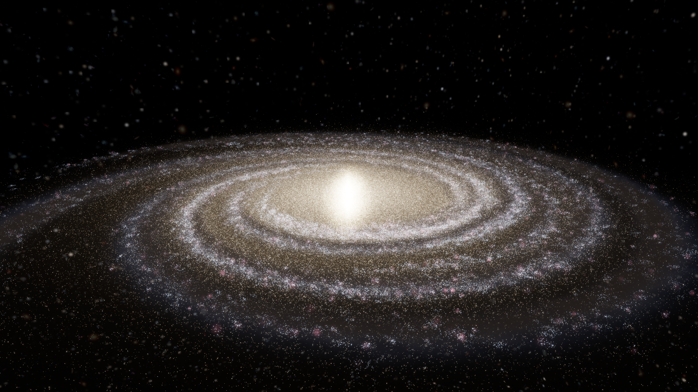

# The Milky Way (claude)

A Windows screen saver of our galaxy, rendered with Vulkan. Claude built it from the shared
template and [prompt.md](prompt.md) as one entry in The Milky Way comparison.



## What you see

- **The galaxy, seen from outside.** 790,000 stars move on the GPU, and a ray-marched volume
  supplies the unresolved light and the dust. Five spiral arms follow the log-spiral fits of
  Reid et al. 2019, extended into whole arms. The model also has a boxy bulge and long bar, a
  nuclear cluster, an exponential thin and thick disk, pink HII regions, and dust lanes on the
  inner edges of the arms.
- **Rotation the right way.** Seen from the North Galactic Pole the Milky Way turns clockwise,
  and its arms trail. Stars follow a flat 233 km/s rotation curve. The bar turns rigidly at
  38 km/s/kpc and the arm pattern at 24 km/s/kpc. Stars in the bar ride elongated orbits that
  turn with it.
  - Young stars and HII regions are born in an arm, at the arm's angle at the time.
  - They then drift downstream at their own orbital speed and fade within 25 to 60 Myr.
  - The arms therefore move as density waves: stars pass through them rather than being carried
    along.
  - `tests/rotation_test.cpp` checks the on-screen direction through the real camera matrices.
- **Time.** Two million years per second.
  - The bar turns once in about 80 s and the arm pattern in about 128 s.
  - The Sun's 215 Myr orbit takes 107 s.
  - Stars within a kiloparsec of the centre lap it in 12 to 16 s.
  - Both the centre and the arms visibly move, and the inner disk visibly outruns the outer.
- **The camera** circles once every seven minutes, counter to the galaxy's spin. Its height and
  distance drift on their own periods, so the view never repeats exactly.
- **The sky** comes from two NASA/ESA Hubble images. Distant galaxies are tiles of the Hubble
  eXtreme Deep Field, and Andromeda comes from the PHAST mosaic. Faint halo stars are added
  procedurally. Andromeda sits where it really is (l = 121.2°, b = −21.6°), drawn five times its
  true size. The camera is outside the Galaxy, so the sky has no Milky Way band.

- **Overlays** are set in Michroma.
  - A film-credit title, "The Milky Way Galaxy", underlined in the lower right. It fades in every
    3 to 4 minutes, holds for 10 s, then fades out.
  - Labels for **Andromeda** and **Sol** (the Sun) appear at random times for 10 s. Each target
    is framed by drawn brackets, with an underlined name and a leader line from the underline to
    the nearest bracket corner.
  - The labels are anchored in 3D: Sol's brackets ride the Sun round its orbit and scale with
    distance, and Andromeda's frame its billboard.
  - A label shows only while its target is on screen, and fades early if the target leaves.
  - See [docs/captures/overlay-0.png](docs/captures/overlay-0.png).

All the research behind these choices is in the shared `C:\_C_Projects\The Milky Way References`,
and the physics note there gives every source.

## Building

MSYS2 UCRT64 (`gcc`, `g++`, `windres`, `glslc`) on `PATH`, plus CMake and Ninja (CLion's bundled
copies work):

```sh
cmake -S . -B build -G Ninja
cmake --build build
ctest --test-dir build
```

The output is `build/the-milky-way-claude.scr`. Right-click it and choose **Install**, or copy it
to `C:\Windows\System32`.

## Development switches

All are environment variables. With none set, the saver behaves as a plain screen saver.

| Variable                 | Effect                                                                 |
|--------------------------|------------------------------------------------------------------------|
| `MILKY_WAY_LOG`          | `1`: trace to `%TEMP%\the-milky-way-claude.log`; anything else is the path. Includes fps every 5 s and GPU time per pass every 300 frames. |
| `MILKY_WAY_CAPTURE`      | In `/w`: write the frame at `MILKY_WAY_CAPTURE_AT` s (default 5) to this png/jpg/bmp and exit. |
| `MILKY_WAY_TIME`         | Start the clock this many seconds in.                                  |
| `MILKY_WAY_OFFSCREEN`    | Draw into an offscreen image instead of the window, unthrottled. This happens anyway when a window's surface can't be queried. |
| `MILKY_WAY_VOLUME_SCALE` | March the volume at 1/n resolution (default 2; 1 for full).            |
| `MILKY_WAY_OVERLAYS`     | The title and both labels on all the time (labels still need their target on screen), for captures. |
| `MILKY_WAY_VALIDATION`   | Enable the Vulkan validation layer.                                    |

`tools/capture.sh <prefix> <t>...` writes captures to `docs/captures/`. `tools/bench.sh` prints
fps and per-pass GPU times. `tools/prepare_sky.py` rebuilds `assets/sky/` from the reference
images.

## Performance

AMD Radeon 8060S, 1600×900, offscreen and unthrottled: about 200 fps.

| Pass            | GPU ms |
|-----------------|--------|
| volume (½ res)  | 1.7    |
| sky + composite | 0.2    |
| stars           | 3.0    |
| bloom           | 0.1    |
| tonemap         | 0.1    |

The volume began at 13.8 ms. Two measured changes brought it down:

- Computing the flow noise once per sample, instead of once for the gas and once for the dust:
  13.8 → 6.7 ms.
- Marching at half resolution: 6.7 → 1.7 ms. Side by side
  ([half](docs/captures/half-140.png) and [full](docs/captures/full-140.png)), the two are
  indistinguishable.

## License

MIT. See [LICENSE](LICENSE). Third-party work, including the Hubble image credits:
[THIRD_PARTY_NOTICES.md](THIRD_PARTY_NOTICES.md).
